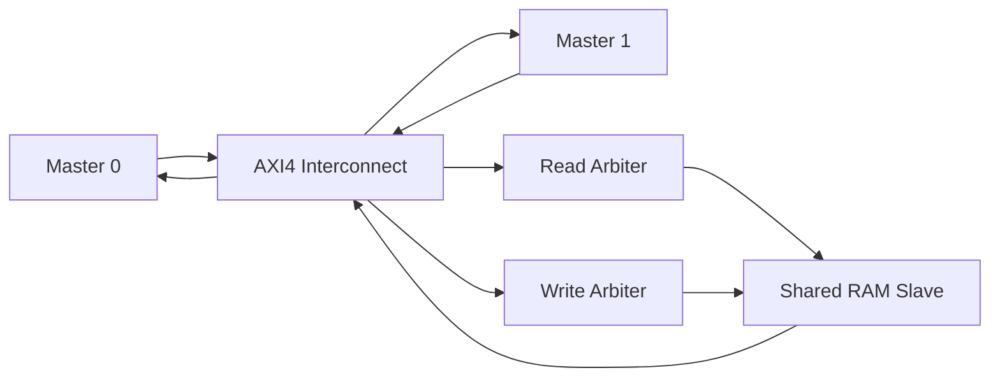

# AXI4 Interconnect Design and Verification

A SystemVerilog implementation of a simplified AXI4 interconnect featuring two masters, round-robin arbitration, and a memory-mapped RAM slave. The project focuses on AXI channel handshaking, burst transactions, arbitration, and functional verification.

## Overview

This project implements a two-master, single-slave AXI4 interconnect. Both masters can request access to a shared memory-mapped RAM, with arbitration logic managing competing transactions.

The design supports FIXED and INCR burst types and uses independent read and write control paths.

## Architecture

## Features

- Two AXI4 master interfaces sharing one memory-mapped RAM slave.
- Round-robin arbitration for competing read and write requests.
- Independent read and write transaction control.
- FIXED and INCR burst support, with a configured maximum of 256 beats.
- FSM-based channel control using AXI VALID/READY handshakes.
- Dual-port RAM-based slave for memory read and write transactions.
- Directed, self-checking SystemVerilog testbench with queue-based scoreboards.
- Verification scenarios covering single-beat and multi-beat transfers, concurrent master requests, and cross-master read-after-write behavior.

## Design Scope

The project deliberately limits complexity to focus on interconnect fundamentals.

- One active transaction per channel at a time.
- FIXED and INCR bursts are supported within the implemented configuration.
- No QoS-based arbitration or protection mechanism.
- No support for multiple outstanding transactions or transaction reordering.
- No automatic splitting of transactions at 4 KB boundaries.

The implementation is a simplified AXI4 interconnect and should not be considered fully AXI4-compliant without further protocol and corner-case verification.

## Verification

The SystemVerilog testbench uses a self-checking approach with queue-based scoreboards to compare expected and observed transaction behavior.

The existing directed scenarios cover:

- Single-beat and multi-beat transfers.
- FIXED and INCR burst transactions.
- Concurrent requests from multiple masters.
- Arbitration between competing requests.
- Read-after-write behavior across masters.

### Additional verification planned

- Reset behavior during idle and active transactions.
- Backpressure and delayed READY responses.
- Correct handling of `WLAST` and `RLAST`.
- Arbitration fairness under sustained contention.
- Correct routing of responses to the requesting master.
- Assertions and functional coverage for critical protocol behavior.

## Linting and Synthesis

RTL linting and synthesis analysis are planned as part of the project validation process.

### Linting
- Run Verilator lint checks.
- Investigate and fix actionable warnings.
- Document any intentional exceptions with justification.
- Re-run lint after modifications to check for regressions.

### Synthesis and timing analysis
- Synthesize the RTL using Cadence Genus.
- Review synthesis warnings and inferred hardware structures.
- Examine the available area and timing reports.
- Run post-synthesis netlist simulation and compare its behavior against RTL simulation.
- Analyze power estimates if suitable switching activity and technology information are available.

Numerical results will be documented after the relevant runs are completed.

## Tools

- **RTL:** Verilog/SystemVerilog
- **Linting:** Verilator
- **Synthesis:** Cadence Genus
- **Verification:** SystemVerilog self-checking testbench
- **Analysis:** Simulation waveforms, synthesis reports, timing and area analysis

## Future Improvements

- Expand protocol assertions and functional coverage.
- Add reproducible lint, simulation, and synthesis scripts.
- Document verified results with simulation logs and waveforms.
- Investigate timing bottlenecks and potential RTL optimizations.
- Extend protocol support only after the current implementation has been thoroughly verified.

## Author

Meghana V

